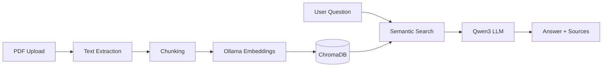

<div align="center">

# 🤖 AI Document Assistant

### Chat with your PDFs — locally and privately.

**A local AI-powered PDF assistant using Retrieval-Augmented Generation (RAG).**

Built with Python, FastAPI, Ollama, Qwen3 and ChromaDB.  
No external AI APIs required.


</div>

---

## ✨ Features

- 🧠 **Local LLM:** Qwen3 1.7B running through Ollama
- 📄 **PDF Processing:** Upload, extract text and automatically index documents
- 🔍 **RAG Search:** Semantic retrieval using embeddings and ChromaDB
- 💬 **AI Chat:** Ask questions about your documents
- 📚 **Source Citations:** Numbered references with PDF names and page numbers
- 🗂️ **Document Management:** Select, filter and delete indexed PDFs
- 🔒 **Privacy:** Local inference and document storage

## 🏗️ Architecture



The application retrieves up to **five relevant text chunks** and uses them as context for Qwen3 to generate document-grounded answers.

## 🛠️ Tech Stack

| Component | Technology |
|---|---|
| Backend | Python, FastAPI |
| LLM | Qwen3 1.7B |
| Model Runtime | Ollama |
| Embeddings | nomic-embed-text |
| Vector Database | ChromaDB |
| PDF Processing | PyMuPDF |
| Frontend | HTML, CSS, JavaScript |

## 🚀 Quick Start

**1. Install dependencies**

```bash
pip install -r requirements.txt
```

**2. Download the models**

```bash
ollama pull qwen3:1.7b
ollama pull nomic-embed-text
```

**3. Start the application**

```bash
python -m uvicorn api:app --reload
```

**4. Open in your browser**

http://127.0.0.1:8000

*Requires Python and a running Ollama installation.*

## 💡 Example

**Question:**  
What is the purpose of the Vienna Explorer application?

**Answer:**  
Vienna Explorer is a mobile travel assistant that helps tourists discover attractions and plan itineraries in Vienna [1][2].

**Sources:**  
`[1]` Vienna Explorer HLD — Page 4  
`[2]` Vienna Explorer HLD — Page 4

The assistant is instructed to acknowledge when information cannot be found in the documents.

## 🗺️ Roadmap

- [x] Local LLM integration
- [x] PDF extraction and indexing
- [x] RAG with semantic search
- [x] FastAPI backend and web interface
- [x] PDF upload and document management
- [x] Document filtering
- [x] Numbered source citations
- [x] Improved retrieval and grounded responses
- [ ] Streaming AI responses
- [ ] Model evaluation and benchmarking
- [ ] Docker deployment

## 🔐 Privacy

PDF processing, vector storage and AI inference run locally. Uploaded documents and the ChromaDB database are excluded from Git.

*This is an experimental project for learning and exploring Generative AI engineering. Source citations are not yet automatically verified.*

---

<div align="center">

**Version 4.7 · Local AI · RAG · Python · FastAPI**

*Built through hands-on experimentation with Generative AI.*

</div>
